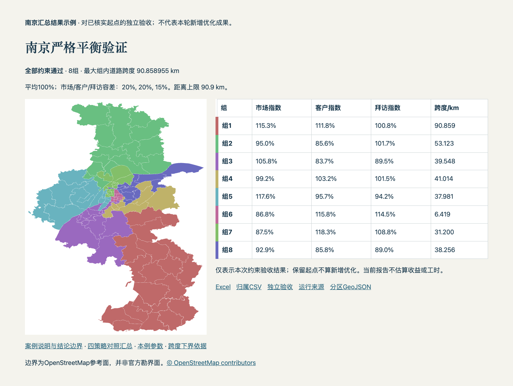
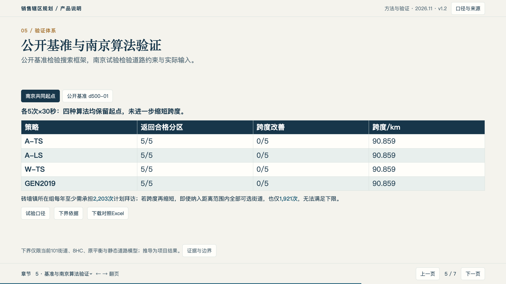

# Territory Planner · 销售辖区规划

本地Python项目：标准数据输入、独立参数配置、研究求解适配、独立验收、结果导出与静态地图报告。

**公开版不包含南京数据。南京案例只保留静态截图**，不提供CSV、Excel、GeoJSON、结果JSON、完整路网或可提取结构化结果的案例HTML。原始本地研究项目与其Git历史未推送到本仓库。

## 设计与使用说明

- [系统设计](docs/DESIGN.md)
- [数据与参数契约](docs/数据与参数契约.md)
- [公开版使用范围](docs/GITHUB.md)
- [参数模板](configs/example.json)

## 安装与测试

当前验证环境为Python 3.10.14。项目声明Python 3.10及以上，其他版本和平台尚需验证。

```bash
python3.10 -m venv .venv
.venv/bin/python -m pip install -r requirements.lock.txt
.venv/bin/python -m pip install -e .
.venv/bin/python -m unittest discover -s tests -v
```

测试使用代码构造的小型图，不需要客户数据，也不调用第三方求解器。

准备自己的授权输入后，可在项目目录使用：

```bash
.venv/bin/territory-plan validate --config configs/example.json
.venv/bin/territory-plan evaluate --config configs/example.json
```

模板本身不附数据，不能直接复算南京案例。配置文件放在`configs/`，数据路径相对项目根目录。每次运行写入独立`runs/`目录，已有目录拒绝覆盖。

## 当前能力与限制

- 独立验收支持指定HC与容差，重算属性、邻接连通、代表点双向通达及组内道路跨度。
- CSV、Excel、GeoJSON、验收JSON与HTML报告使用同一分配结果。
- `solve`仅接入此前已验证的固定研究模型，不能通过修改配置获得任意城市、人数或目标的求解能力。公开仓库不附研究二进制或本机注册文件。
- 作者研究程序有其原有许可限制；不将它们打包或宣传为已授权商用组件。此仓库未添加项目开源许可证。
- 无网页上传/任务队列、收益预测或实际工时模型。

## 南京案例截图

以下是既有结果的视觉展示，不是本仓库附带可复算数据；四种算法保留同一起点不能算作新优化成果。





截图中边界为参考面，来源：[© OpenStreetMap contributors](https://www.openstreetmap.org/copyright)。不等于官方勘界面，也不代表实际工时或收益最优。
