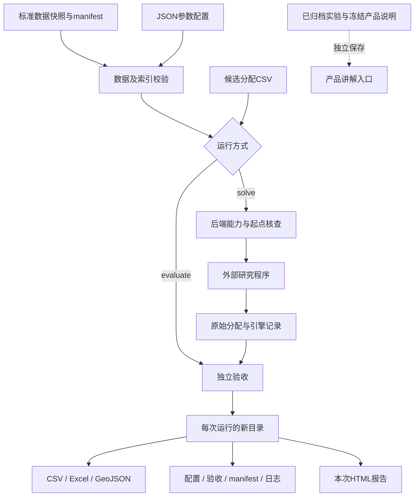

# 销售辖区规划系统设计

| 项目 | 说明 |
|---|---|
| 文档状态 | 对照v0.1.0代码编写；区分已实现与规划 |
| 文档日期 | 2026-11-02 |
| 产品形态 | 本地Python CLI、文件配置、独立验收与静态HTML报告 |
| 核心链路 | 数据输入 → 参数设置 → 求解或直接验收 → 结果输出 → 展示 |

## 1. 背景与目标

销售辖区规划需要同时考虑地理单元、市场和客户属性、维护责任以及道路通行条件。单纯按行政区拼接、平衡客户数或缩短直线距离，都不能替代对业务约束与真实路网的核查。

本项目将已有研究流程整理为可追溯的工程流程：输入和参数独立管理，求解器输出经过另一套验收逻辑核查，地图与指标使用同一分配结果，历史实验与新运行分开保存。

v0.1.0目标：

1. 为聚合后的地理单元、属性、邻接和道路数据建立输入契约。
2. 支持检查候选是否满足指定HC、平衡、连通和距离要求。
3. 接入已有南京研究程序，保留方法、种子、预算和版本记录。
4. 生成可核查的数据结果与真实边界HTML，不依赖外部地图服务。

当前不包含原始门店Excel自动匹配、坐标转换、任意城市通用求解、批量任务调度、网页上传配置界面、收益预测或云部署。此类工作不能通过修改配置名称被视为已经实现。

## 2. 使用者与典型流程

| 使用者 | 主要工作 | 当前入口 |
|---|---|---|
| 数据准备人员 | 聚合单元指标、核实边界及路网索引、制作数据清单 | 标准数据目录与契约文档 |
| 规划分析人员 | 设置参数、验证输入、检查已有分区、调用适配器 | CLI与JSON配置 |
| 方案评审人员 | 查看地图、百分比指标、验收及实验边界 | 每次运行的HTML、Excel及JSON |
| 维护开发人员 | 扩展适配器、复核版本与回归行为 | 源码、测试及运行清单 |

流程有两条独立路径：

- 已有候选：`validate`检查数据后，`evaluate`直接验收和导出，不调用研究程序。
- 需要搜索：`solve`先验收共同起点并检查后端兼容性，再调用外部程序，最后独立验收返回候选。

## 3. 总体架构

求解器负责生成候选；验收器负责重算是否满足要求。后端声称成功、退出码为0或保留了起点，都不能代替独立验收。

## 4. 模块职责

| 模块 | 职责 | 不承担的职责 |
|---|---|---|
| `data.py` | 读取配置与清单；检查哈希、指标、索引、边界数量及分配完整性 | 自动修复客户身份、行政边界或错误路网 |
| `evaluation.py` | 重算组属性、邻接连通、代表点双向通达和组内跨度 | 搜索分区、预测销量或计算实际工时 |
| `cli.py` | 命令编排、后端兼容性检查、子进程调用、结果追溯 | 通用HC求解、任务队列或网页API |
| `report.py` | 输出数据表、GeoJSON和静态真实边界报告 | 重新求解或改变结果以美化指标 |
| 本地私有迁移工具 | 从既有本地研究目录一次性整理南京快照及归档 | 公共数据下载器或任意数据导入器 |
| 本地私有集成检查工具 | 检查南京本地集成流程及后端拒绝逻辑 | 在无南京数据环境下替代单元测试 |

配置文件按当前实现放在项目根目录下的`configs/`；项目根目录由配置文件所在目录的上一级推导。数据和分配默认路径相对项目根目录解析；`--assignment`与`--output`作为显式本地路径处理。

## 5. 数据设计

详细字段见[数据与参数契约](数据与参数契约.md)。

| 文件 | 核心约定 |
|---|---|
| `units.csv` | `unit_id`按0～N−1连续排列；三项属性为market、customers、visits |
| `adjacency.csv` | u、v引用单元ID；通行支持关系在上游核实 |
| `boundaries.geojson` | Polygon/MultiPolygon，顺序与单元表一致 |
| `roads.npz` | 有向稀疏图，非负有限公里边权 |
| `road_nodes.npz` | street映射道路节点所属单元；rep_indices提供每单元代表道路节点 |
| 分配CSV | unit_id、territory_id；各单元恰好一次，辖区编号1～K且非空 |
| `manifest.json` | 输入文件哈希、数据版本、来源与统计口径 |

`unit_id`、GeoJSON行序、street和rep_indices构成统一索引契约。哈希验证可以发现快照变化，但不能证明原始客户数据或边界本身真实无误；语义正确性仍需数据准备阶段确认。

客户数量仅代表提供的数据范围；未关联记录不能直接当未开发。计划拜访按已确认制度加工，不等于实际工作时长。坐标转换、营业状态和客户身份核实属于上游职责。

## 6. 参数与数学模型

设地理邻接图为G=(V,E)，单元i的第m项属性为aᵢₘ，xᵢₖ表示单元是否归属辖区k。

- 唯一分配：Σₖxᵢₖ=1。
- 各辖区非空，且Vₖ在邻接图上连通。
- 属性总量：Aₖₘ=Σᵢaᵢₘxᵢₖ；全市平均：μₘ=Σᵢaᵢₘ/K。
- 三项平衡：|Aₖₘ/μₘ−1|≤τₘ。容差0.2表示相对平均±20%，不是全市份额20%。
- 距离：d⁽Vₖ⁾ᵢⱼ在辖区所属道路节点构成的诱导有向路网上计算。
- 最大跨度：D(x)=maxₖ maxᵢ,ⱼ∈Vₖ d⁽Vₖ⁾ᵢⱼ；要求D(x)≤Dmax，研究目标为最小化D(x)。

代表点在任一方向不通达则该辖区不通过。验收并不要求所有道路支路属于一个强连通分量，只检查本组代表点之间双向可达。道路公里不是驻点半径、日拜访路线、拥堵时间或成本。

### 能力边界

| 能力 | v0.1.0状态 |
|---|---|
| 指定K与容差，验收已有候选 | 已实现；输入仍须满足统一道路数据契约 |
| 南京固定8HC研究求解 | 已接入，须有匹配的外部本机程序 |
| 改变K、平衡或距离后直接使用当前研究后端 | 明确拒绝，防止配置与固化模型不一致 |
| 任意城市、扩编/缩编求解 | 待适配与专项验证 |
| 其他目标、通行时间、动态需求、收益联合优化 | 未实现 |

## 7. 求解适配器设计

当前`adapters/research.json`注册四种策略及其外部可执行文件、哈希和启动参数。A-TS、A-LS、W-TS来自2018同一实现的配置，GEN2019来自另一实现；不能称为四篇独立论文复现。

`solve`执行以下检查与步骤：

1. 数据有效，候选完整，先独立验收起点。
2. HC、三项容差、90.9km上限与固化研究模型一致。
3. 数据manifest与适配器登记一致；外部程序文件和哈希匹配。
4. 起点通过全部要求后，导出零基编号的warm_start.txt。
5. 通过子进程和`CTDP_WARM_START`调用外部程序；每次一个方法、一个种子。
6. 检查退出状态与原始分配格式；重新验收返回结果，分别报告可行与严格改善起点。

原始输入格式与内部道路二进制作为后端私有格式管理，不作为通用数据契约。当前没有自动重建任意K二进制、插件发现机制或批量调度器。

研究后端包含精确组内路由、道路门禁、缓存调整、共同起点与可行档案等项目改编。目标相同时保留已有档案；最终返回起点不算新优化成果，也不能用ARI=1宣传稳健性提升。

## 8. 独立验收流程

对每组依次执行：

1. 从单元属性重新汇总三项总量，计算相对全市平均的指数。
2. 用邻接子图检查单元连通。
3. 按分配筛选所属道路节点并提取诱导有向子图。
4. 用强连通分量检查代表点是否互通。
5. 通过后，用Dijkstra计算各代表点到其余代表点的最短路，求组内最大值。
6. 汇总全部组的平衡、连通、道路通达和距离检查。

只有全部条件通过时`accepted=true`。输出不能以“平均指标达标”代替逐组检查，也不能把全市路网中的更短路径冒充禁止跨辖区道路后的距离。

## 9. 输出与追溯

默认输出目录为`runs/UTC时间编号/`；显式输出路径存在时拒绝覆盖。

| 文件 | 内容 |
|---|---|
| config.json | 本次完整配置 |
| manifest.json | 版本、代码哈希、配置及输入来源、Python/依赖、后端方法/种子/预算/程序哈希 |
| audit.json | 各组与总体的独立检查、可行状态；solve另给严格改善字段 |
| assignments.csv | 本次单元归属及属性 |
| territories.csv、results.xlsx | 各组属性、平均100%指数及跨度 |
| territories.geojson | 原边界附加本次单元与辖区ID |
| report.html | 与上述分配一致的地图、表格与下载链接 |
| 研究运行附加文件 | warm_start.txt、raw_assignment.txt、internal_search.json及标准输出/错误日志 |

`validate`仅校验，不创建结果包。`evaluate`只验收候选；其严格改善字段为null。`solve`相对起点判断严格跨度改善。

已处理的错误返回退出码2；验收不合格也返回2，但正常导出验收报告。求解或导出失败可能留下部分文件及failure.json，不能把“目录存在”解释为运行成功。当前没有原子提交、并发目录锁或可恢复任务状态机；调用方必须读取成功退出状态及audit.json，而非猜测文件名。

## 10. 展示分层

- `index.html`是本地项目导航，不是可上传数据和启动任务的网页应用。
- `runs/.../report.html`展示一次实际运行，允许纵向阅读，不混入其他配置结果。
- `presentation/product.html`是已审核产品讲解的冻结材料，不会随新运行自动更新。
- `experiments/`标注历史导入及来源，与新运行分开。
- 公开仓库仅保留南京结果截图；不包含南京数据、结构化结果、可提取数据的报告HTML或完整输入。

严格平衡与距离优先情景可能采用不同属性要求和优化目标，不能直接按距离排名。私有案例中的下界证明仅适用于原数据及约束，不能自动推广到其他城市或参数。

## 11. 关键设计取舍

| 决策 | 理由 | 代价或限制 |
|---|---|---|
| 文件配置与CLI优先 | 易于保存口径和重现，无服务器依赖 | 暂无网页操作界面 |
| 求解与验收分离 | 避免只信任求解器自报结果 | 验收有额外路由计算成本 |
| 使用真实道路而非纯直线代理 | 表达跨江、绕行及组内可达要求 | 模型依赖道路快照与代表点选择 |
| 输入按版本冻结，输出不覆盖 | 保留试验来源与历史 | 增加存储与数据准备工作 |
| 固化后端严格拒绝不支持配置 | 避免表面可配、实际未生效 | 任意城市和K需扩展后端 |
| 地图、运行报告与产品讲解分离 | 防止展示材料混用不同模型结果 | 产品说明更新需独立核查 |

## 12. 验证策略及已知限制

无客户数据的单元测试覆盖：重复或遗漏归属、非整数辖区、编号排序、合法双向道路分区、禁止借用别组道路、单向可达不足以合格。

有授权本地数据时再执行南京集成验证：输入校验、独立起点验收、3秒真实后端接入、固化配置拒绝及结果包检查。已有20次算法对照是历史归档，不是每次安装都会重新运行的测试。

本地已核验静态入口和报告的桌面/手机视图。尚未建立GitHub Actions、跨操作系统后端构建、大规模性能基准、任意输入模糊测试或整套故障注入测试。当前拒绝非有限/负指标、索引错位和哈希变化，不等于已经覆盖所有恶意或损坏文件。

## 13. 后续扩展

依次考虑：公开可分发的合成演示数据；通用后端输入构建与能力声明；不同K及城市验证；批量种子调度；在最大跨度相同情况下的显式次级目标；最后再考虑网页操作界面。每项必须新增可验证的输入、参数和测试，不通过扩大产品文案来代替实现。

收益、工时和动态需求扩展须先取得对应业务数据并定义目标；不能直接将历史销量、客户数或菜系数量当作该目标。

## 14. 方法来源与授权边界

- [2018搜索方法论文入口](https://doi.org/10.1007/978-3-319-77449-7_11)：原搜索框架及策略配置。
- [2019通用区划方法论文入口](https://doi.org/10.1145/3321707.3321874)：直径或中心目标的区划搜索框架。
- [作者公开实现](https://github.com/AlexGliesch/commdis)：外部研究适配器的代码来源。

这些来源不提供南京三项容差、90.9km、TOP拜访制度或本项目下界推导的通用参数依据。原研究程序的许可含非商业限制；本项目不将它们重新打包为商用授权组件。项目自身源码的发布许可也须由所有者确定，不能从引用论文推断授权。

仓库边界与干净环境使用方式见[GitHub使用与提交说明](GITHUB.md)。
